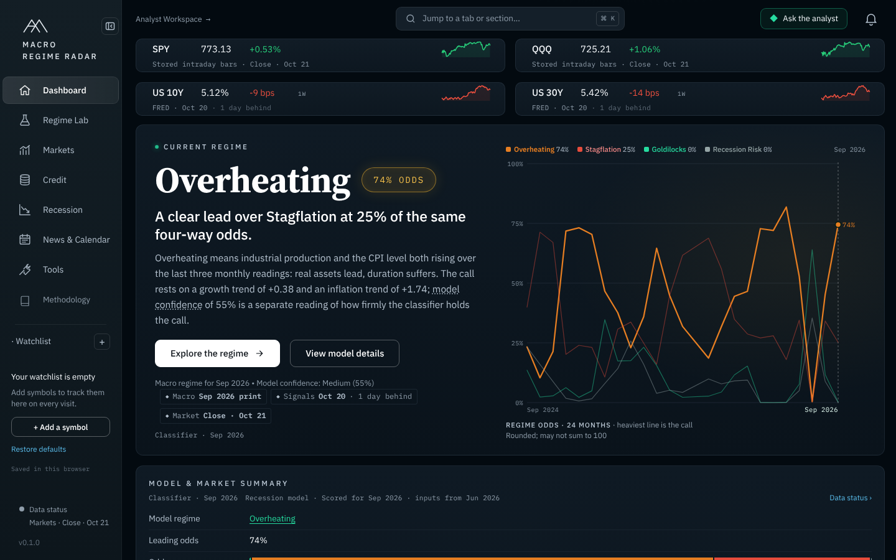
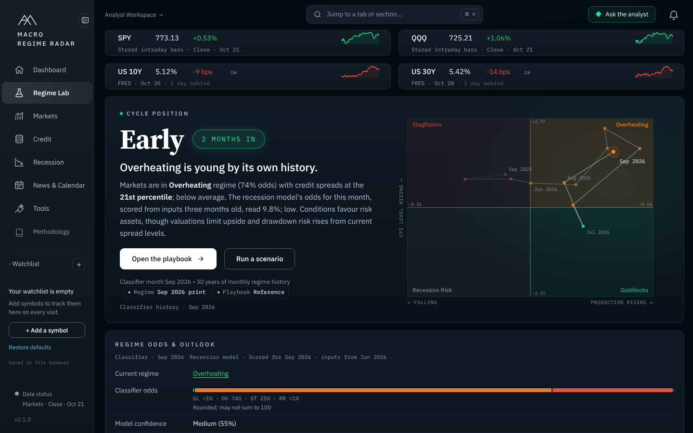
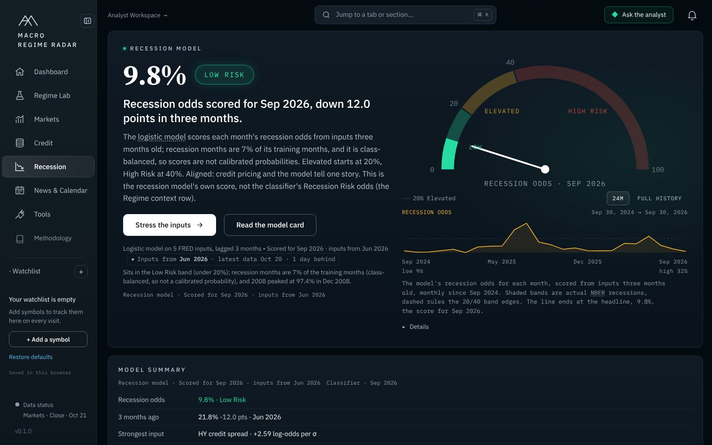
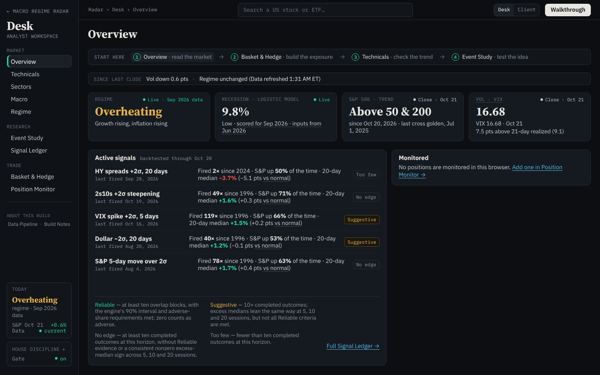
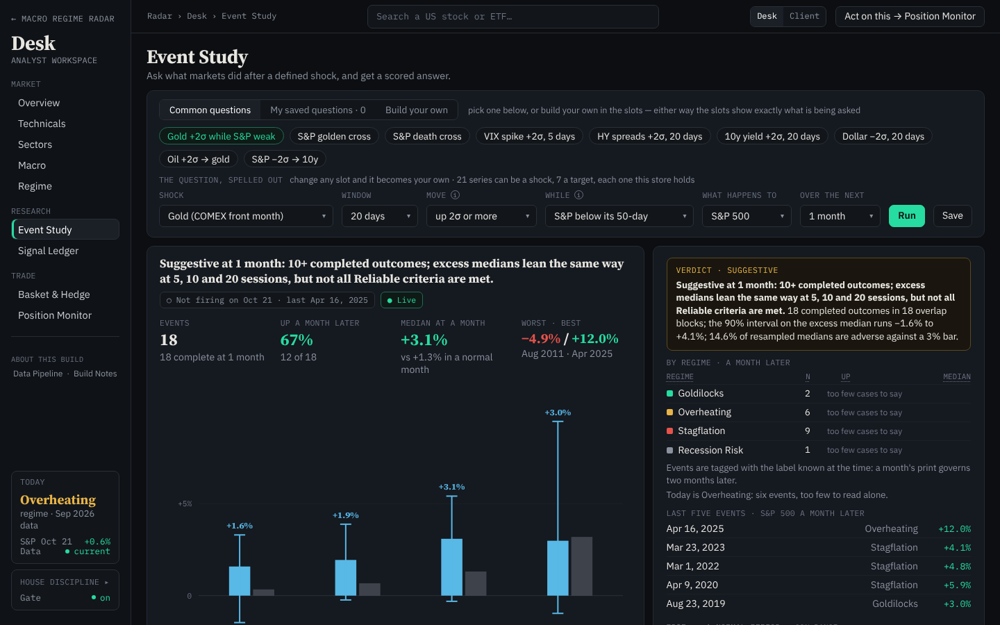
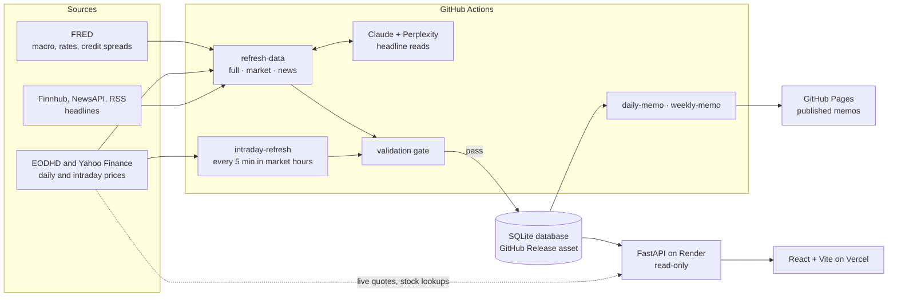

# Macro Regime Radar

**A live macro terminal that reads the US economy into one of four regimes every month, then shows the evidence, the models and the data trail underneath.**

**[Open the live site →](https://macro-economic-radar.vercel.app)** · [Analyst Desk](https://macro-economic-radar.vercel.app/desk/overview) · [Methodology](https://macro-economic-radar.vercel.app/app/methodology) · [Today's daily memo](https://maxkomen-macro.github.io/macro-regime-radar/memo/daily_memo.html)



Macro Regime Radar is a one-person project: a React and TypeScript front end, a FastAPI service, and a data pipeline that runs itself on GitHub Actions. It pulls macro data from FRED, market prices and headlines; classifies the economy as **Goldilocks, Overheating, Stagflation or Recession Risk**; scores recession odds with a separate model; and publishes daily and weekly briefings. Every number on the site carries the date of the data behind it.

It is built for three kinds of visitors: someone who wants the macro picture in ten seconds, an analyst who wants to test an idea against history, and an engineer who wants to see how a small, fully automated data product is put together.

---

## What's on the site

The site has two parts: the **terminal**, with seven tabs plus Methodology, and the **Analyst Desk**, a research and trading workspace.

### The terminal

| Tab | What you can do there |
|---|---|
| **Dashboard** | See the current regime with its odds, the five monitored signals, key market levels, what markets are pricing, and the main macro charts. |
| **Regime Lab** | Read the regime's playbook, where it sits in the cycle, the odds of moving to another regime, historical analogues, a scenario builder, the full regime history, and backtests with factor attribution. |
| **Markets** | Research any US stock or ETF, watch the macro tape, scan the sector heatmap, and see what markets are pricing and the biggest data surprises. |
| **Credit** | Track investment-grade and high-yield spreads by rating, the quality ladder, and financing conditions. |
| **Recession** | See the recession model's score, the yield-curve monitor, and sliders that show how each input moves the odds. |
| **News & Calendar** | Read priority headlines, each scored for significance and the top ones with a Claude interpretation and cited research, beside the macro release calendar. |
| **Tools** | Run an LBO calculator, or an asset allocator with seven optimizers (mean-variance, minimum variance, risk parity, Black-Litterman, HRP, HERC and CVaR) built on how each asset class did in each regime. |
| **Methodology** | How every model works, what it can and cannot claim, and where each number comes from. |

Around the tabs: a market strip, an **"Ask the analyst"** assistant that answers questions from the stored data, a ⌘K palette to jump to any section, an alerts drawer, and a **Data status** drawer that shows how current each feed is.

<table>
  <tr>
    <td></td>
    <td></td>
  </tr>
</table>

### The Analyst Desk

The Desk turns a macro view into a testable trade idea.

- **Market:** Overview (what fired, and what is closest to being wrong), Technicals for the S&P 500 or any US stock, sector leadership and breadth, Macro & Correlations, and the regime with the data prints that would change it.
- **Research:** an **Event Study** engine that answers "what did markets do after this kind of shock?" with a scored verdict (Reliable, Suggestive, No edge or Too few), and a **Signal Ledger** of every scored signal.
- **Trade:** **Basket & Hedge** prices a basket from real prices and sizes an ETF hedge; **Position Monitor** tracks how far each position is from being wrong.
- **About this build:** a Data Pipeline page that traces every panel to its source, and Build Notes.

A few Desk cards (options hedging, positioning, an event study on your basket, the volatility column on Technicals, and a Snowflake sync) are **prototypes**: they are drawn finished with illustrative values and say so in a footnote. They will be wired to live data over the coming weeks.

<table>
  <tr>
    <td></td>
    <td></td>
  </tr>
</table>

---

## How the regime call works

1. **Growth and inflation trends.** Each month the pipeline fits the three-month slope of industrial production and of the CPI level.
2. **Four quadrants.** Rising growth with falling inflation is Goldilocks; both rising is Overheating; falling growth with rising inflation is Stagflation; both falling is Recession Risk.
3. **Odds, not just a label.** A temperature-scaled softmax over how far each trend sits from its own history turns that into odds for all four regimes, so the site can say how narrow the lead is.
4. **A separate recession model.** A logistic regression trained on NBER recession dates scores recession odds from the yield curve, unemployment, the high-yield credit spread, industrial production and the inflation-breakeven spread, read three months earlier. It is labelled as its own model and never mixed with the classifier's odds.

The [Methodology page](https://macro-economic-radar.vercel.app/app/methodology) covers the signals, the backtests and the limits of each model.

---

## Architecture



**Data pipeline.** Scheduled GitHub Actions workflows fetch macro series from FRED, prices from Yahoo Finance and EODHD, and headlines from Finnhub, NewsAPI and RSS feeds. A full refresh runs before the US open and after the close, market prices update every five minutes during trading hours, and news updates hourly. The most significant headlines get a Claude interpretation and Perplexity research with citations.

**Database as a release asset.** The SQLite database is not stored in git. Each run downloads the latest copy from a GitHub Release, updates it, and runs a validation gate (integrity, row counts, date regressions, and freshness by source). The run publishes the database back only if the gate passes, so a bad run never replaces a good database.

**API.** A FastAPI service on Render downloads the published database and opens it read-only. A background worker computes every model result once per database version, and each request is pinned to one version, so a page never mixes numbers from two versions of the data. The same service relays live quotes and answers on-demand stock lookups, keeping provider keys on the server.

**Front end.** A React 18 and TypeScript app built with Vite and hosted on Vercel, using TanStack Query for data and a hand-built dark design system. The build ships a validated snapshot, so the main pages render even while the API is waking up.

**Briefings.** After a validated morning refresh, the pipeline builds the daily memo on weekdays and the weekly memo on Mondays, emails them, and publishes them to GitHub Pages.

---

## Engineering highlights

- **Freshness is part of the data.** Every series reports whether it is live, delayed, at the last close, or stale, judged against that source's normal publishing lag and the NYSE and bond-market calendars.
- **The event-study engine is careful about evidence.** It uses the NYSE session calendar, counts only data that was knowable at the time, and resamples overlapping events as blocks, so one selloff isn't counted as five pieces of evidence.
- **The AI is fenced in.** The assistant answers through a fixed set of read-only tools over the stored data, and the headline interpretations on the site are written once by the pipeline and stored, not generated when a page loads.
- **Tested.** About 1,400 Python test functions, 150 front-end test files, and Playwright end-to-end specs.

---

## Data model

The SQLite store holds, among others:

| Table | What it holds |
|---|---|
| `raw_series` | FRED macro series, one row per month |
| `regimes` | The monthly regime label, its trends, confidence and the four regime odds |
| `signals` | The five monitored signals and whether each has triggered |
| `market_daily`, `market_intraday` | Daily and five-minute bars for the market strip and tape |
| `asset_prices`, `desk_series` | Long daily histories for allocation and the Desk's engine |
| `news_feed` | Headlines with significance scores, Claude interpretations and cited research |
| `event_calendar` | Upcoming macro releases |
| `backtest_results` | Regime backtests |
| `source_watermarks` | The true date of each source's newest observation |

---

## Tech stack

| Layer | Tools |
|---|---|
| Front end | React 18, TypeScript, Vite, TanStack Query, Vitest, Playwright |
| API | Python, FastAPI, Uvicorn, WebSockets, httpx |
| Analytics | pandas, NumPy, scikit-learn, riskfolio-lib, exchange_calendars |
| Data | SQLite, FRED, EODHD, Yahoo Finance, Finnhub, NewsAPI, RSS |
| AI | Anthropic Claude, Perplexity Sonar |
| Infrastructure | GitHub Actions, GitHub Releases, GitHub Pages, Vercel, Render, Docker |

---

## Project structure

```
web/        React + TypeScript front end: landing page, terminal, Analyst Desk
api/        FastAPI service: routes, background worker, market data providers, live relay
src/        Data pipeline and analytics: regime classifier, recession model,
            allocation, credit, news, and the event-study engine (src/desk/)
scripts/    Database validation and maintenance tools
tests/      Python test suite
.github/    Scheduled refresh, intraday and memo workflows
docs/       Methodology notes, design specs and build reports
```

---

## Contact

Built by **Max Komen**. [LinkedIn](https://www.linkedin.com/in/max-komen) · [maxkomen@gmail.com](mailto:maxkomen@gmail.com)

*Nothing on the site is investment advice.*
