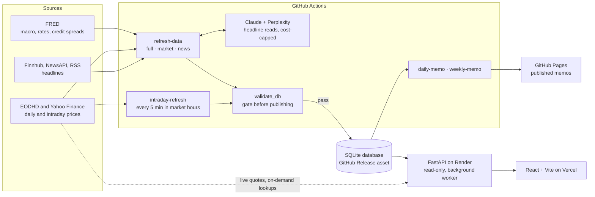

# Macro Regime Radar

**A live macro terminal that reads the US economy into one of four regimes every month, then shows the evidence, the models and the data trail underneath.**

**[Open the live site →]({{LIVE_URL}})** · [Analyst Desk]({{LIVE_URL}}/desk/overview) · [Methodology]({{LIVE_URL}}/app/methodology) · [Today's daily memo](https://maxkomen-macro.github.io/macro-regime-radar/memo/daily_memo.html)


Macro Regime Radar is a one-person project: a React and TypeScript front end, a FastAPI service, and a data pipeline that runs itself on GitHub Actions. It pulls macro data from FRED, market prices, and headlines; classifies the economy as **Goldilocks, Overheating, Stagflation or Recession Risk**; scores recession odds with a separate model; and publishes daily and weekly briefings. Every number on the site carries the date of the data behind it.

It is built for three kinds of visitors: someone who wants the macro picture in ten seconds, an analyst who wants to test an idea against history, and an engineer who wants to see how a small, fully automated data product is put together.

---

## What's on the site

The site has two parts: the **terminal** (`/app`), seven tabs plus Methodology, and the **Analyst Desk** (`/desk`), a research and trading workspace.

### The terminal

| Tab | What you can do there |
|---|---|
| **Dashboard** | See the current regime with its odds, the five monitored signals, key market levels, what markets are pricing, and the main macro charts. |
| **Regime Lab** | Read the regime's playbook, where we are in the cycle, the odds of moving to another regime, historical analogues, a scenario builder, the full regime history, and backtests with factor attribution. |
| **Markets** | Research any US stock or ETF (price history, corporate actions, options), watch the macro tape, scan the sector heatmap, and see the biggest data surprises. |
| **Credit** | Track investment-grade and high-yield spreads by rating, the quality ladder, and financing conditions. |
| **Recession** | See the recession model's score, the yield-curve monitor, and sliders that show how each input moves the odds. |
| **News & Calendar** | Read priority headlines, each scored for significance and the top ones with a Claude interpretation and cited research, beside the macro release calendar. |
| **Tools** | Run an LBO calculator, or an asset allocator with seven optimizers (mean-variance, minimum variance, risk parity, Black-Litterman, HRP, HERC, CVaR) fitted to the current regime. |
| **Methodology** | How every model works, what it can and cannot claim, and where each number comes from. |

Around the tabs: a live ticker strip, an **"Ask the analyst"** assistant that answers questions from the stored data, a ⌘K palette to jump to any section, and a **Data status** drawer that shows how current each feed is.

### The Analyst Desk

The Desk turns a macro view into a testable trade idea.

- **Market:** Overview (what fired and what is closest to being wrong), Technicals for the S&P 500 or any US stock, sector leadership and breadth, rates and correlations, and the regime with the data prints that would change it.
- **Research:** an **Event Study** engine that answers "what did markets do after this kind of shock?" with a scored verdict (Reliable, Suggestive, No edge, Too few), and a **Signal Ledger** of every scored signal.
- **Trade:** **Basket & Hedge** prices a basket from real prices and sizes an ETF hedge; **Position Monitor** tracks how far each position is from its stop.
- **About this build:** a Data Pipeline page that traces every panel to its source, and Build Notes.


---

## How the regime call works

1. **Growth and inflation trends.** Every month the pipeline measures the three-month trend of industrial production and of the CPI level.
2. **Four quadrants.** Rising growth and falling inflation is Goldilocks; both rising is Overheating; falling growth with rising inflation is Stagflation; both falling is Recession Risk.
3. **Odds, not just a label.** A temperature-scaled softmax over the two trends' z-scores turns that into odds for all four regimes, so the site can say how narrow the lead is.
4. **A separate recession model.** A logistic regression trained on NBER recession dates scores the odds of recession from the yield curve, credit spreads, breakevens, unemployment and industrial production. It is labelled as its own model, never mixed with the classifier's odds.

The [Methodology page]({{LIVE_URL}}/app/methodology) covers the signals, the backtests, and the limits of each model.

---

## Architecture



**Data pipeline.** Scheduled GitHub Actions workflows fetch macro series from FRED, prices from EODHD and Yahoo Finance, and headlines from Finnhub, NewsAPI and RSS feeds. A full refresh runs before the US open and after the close; market data updates every five minutes during trading hours; news updates hourly. The top headlines get a Claude interpretation and Perplexity research, under an hourly limit and a monthly spending cap that every call is logged against.

**Database as a release asset.** The SQLite database is not stored in git. Each run downloads the latest copy from a GitHub Release, updates it, and runs a validation gate (integrity, row counts, date regressions, freshness by source). It publishes the database back only if the gate passes, along with a small file recording the verdict. A bad run never replaces a good database.

**API.** A FastAPI service on Render downloads the published database and opens it read-only. A background worker computes every model result once per database version, called a generation, and each request is pinned to one generation, so a page never mixes numbers from two versions of the data. The service also relays live quotes over a WebSocket without exposing the provider key, and applies rate limits, request size caps and a daily budget for the AI assistant.

**Front end.** A React 18 and TypeScript app built with Vite and hosted on Vercel, using TanStack Query for data and a hand-built design system. The build ships a validated snapshot, so the main pages render even while the API host is waking up.

**Briefings.** After a validated morning refresh, the pipeline builds a daily memo (and a weekly one on its schedule), emails it, and publishes it to GitHub Pages.

---

## Engineering highlights

- **Freshness is part of the data.** Every series reports whether it is live, delayed, at the last close, or stale, judged against that source's normal publishing lag and the NYSE and bond-market calendars.
- **The event-study engine is careful about evidence.** It uses the NYSE session calendar, only counts data that was knowable at the time, and resamples overlapping events as blocks so one selloff isn't counted as five pieces of evidence.
- **The AI is fenced in.** The assistant can only run read-only queries through a shared SQL guard, and every model call is checked against a spending ledger before it is made.
- **Tested end to end.** About 1,400 Python test functions and 150 front-end test files, plus Playwright end-to-end specs.

---

## Tech stack

| Layer | Tools |
|---|---|
| Front end | React 18, TypeScript, Vite, TanStack Query, Vitest, Playwright |
| API | Python 3.12, FastAPI, Uvicorn, WebSockets, httpx |
| Analytics | pandas, NumPy, scikit-learn, riskfolio-lib, exchange_calendars |
| Data | SQLite, FRED, EODHD, Yahoo Finance, Finnhub, NewsAPI, RSS |
| AI | Anthropic Claude, Perplexity Sonar |
| Infrastructure | GitHub Actions, GitHub Releases, GitHub Pages, Vercel, Render, Docker |

---

## Repository layout

```
web/        React + TypeScript front end (terminal, Analyst Desk, landing page)
api/        FastAPI service: routes, background worker, providers, live relay, security
src/        Data pipeline and analytics: regime classifier, recession model,
            allocation, credit, news, event-study engine (src/desk/)
scripts/    Database validation, snapshots, fixtures, maintenance tools
tests/      Python test suite
.github/    Scheduled refresh, intraday, memo and keep-warm workflows
docs/       Methodology notes, design specs and build reports
dashboard/  The original Streamlit version of the app
```

---

*Macro Regime Radar is a personal project. Nothing on the site is investment advice.*
